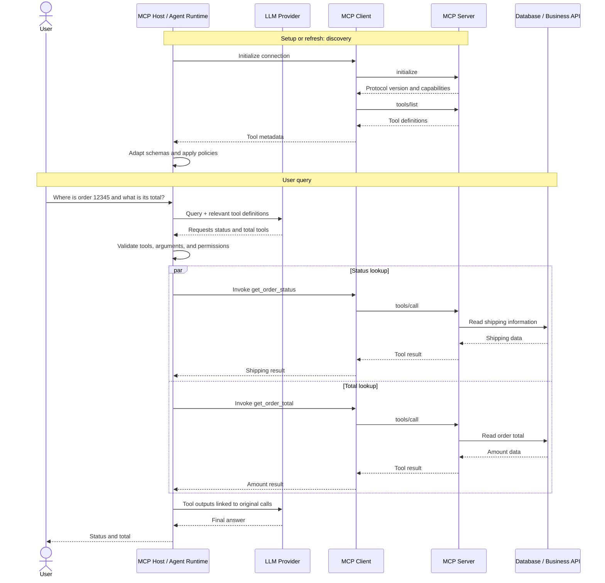

# Model Context Protocol (MCP): Complete Learning Notes

> A practical, end-to-end guide to MCP for engineers learning AI agents. Covers the mental model, architecture, protocol lifecycle, tools/resources/prompts, Python examples, LLM tool calling, execution workflow, transports, enterprise security, reliability, testing, and a capstone roadmap.

## Table of Contents

1. [Learning Goals](#1-learning-goals)
2. [What Is MCP?](#2-what-is-mcp)
3. [MCP vs. REST APIs vs. LLM Tool Calling](#3-mcp-vs-rest-apis-vs-llm-tool-calling)
4. [Core Architecture](#4-core-architecture)
5. [Host, Client, Server, LLM, and Business System](#5-host-client-server-llm-and-business-system)
6. [Protocol Lifecycle and JSON-RPC](#6-protocol-lifecycle-and-json-rpc)
7. [MCP Primitives: Tools, Resources, and Prompts](#7-mcp-primitives-tools-resources-and-prompts)
8. [Build an MCP Server in Python](#8-build-an-mcp-server-in-python)
9. [Build an MCP Client in Python](#9-build-an-mcp-client-in-python)
10. [How MCP Tools Become LLM Tools](#10-how-mcp-tools-become-llm-tools)
11. [End-to-End Query Workflow](#11-end-to-end-query-workflow)
12. [How Many LLM and MCP Calls Happen?](#12-how-many-llm-and-mcp-calls-happen)
13. [Multiple MCP Servers and Tool Routing](#13-multiple-mcp-servers-and-tool-routing)
14. [Application-Managed vs. Provider-Managed MCP](#14-application-managed-vs-provider-managed-mcp)
15. [Transports: stdio and Streamable HTTP](#15-transports-stdio-and-streamable-http)
16. [Enterprise Agent Architecture](#16-enterprise-agent-architecture)
17. [Security and Authorization](#17-security-and-authorization)
18. [Reliability and Observability](#18-reliability-and-observability)
19. [Testing and Evaluation](#19-testing-and-evaluation)
20. [Recommended Project Structure](#20-recommended-project-structure)
21. [Capstone Project Roadmap](#21-capstone-project-roadmap)
22. [Common Misunderstandings](#22-common-misunderstandings)
23. [Knowledge Check](#23-knowledge-check)
24. [Official References](#24-official-references)

---

## 1. Learning Goals

After working through this guide, you should be able to:

- Explain what MCP solves and where it fits into an AI-agent architecture.
- Distinguish an MCP Host, MCP Client, MCP Server, LLM, and business system.
- Understand the MCP initialization and tool-discovery lifecycle.
- Build a basic MCP server and client in Python.
- Explain how MCP tool metadata is adapted into an LLM provider's tool schema.
- Trace a user query through tool selection, execution, and final response.
- Understand when discovery occurs and how many LLM/tool calls a workflow may require.
- Design for multiple MCP servers, authorization, reliability, observability, and testing.

This document is a learning guide. Code examples are intentionally small and should be adapted, tested, and secured before production use.

---

## 2. What Is MCP?

**MCP stands for Model Context Protocol.** It is an open protocol that standardizes how AI applications connect to external tools, data sources, and other capabilities.

Imagine an AI customer-support agent that needs to:

- Retrieve an order from an order service.
- Search company refund policies.
- Read customer information from a CRM.
- Create a support ticket.
- Query an internal database.

Without a common integration approach, each agent may need a custom integration for every backend system. MCP provides a standard interface for exposing capabilities to MCP-compatible applications.

### Without a common protocol

```text
Agent A ── custom order integration
Agent A ── custom CRM integration
Agent B ── different order integration
Agent B ── different CRM integration
```

This duplicates code and makes integrations harder to maintain.

### With MCP

```text
                AI APPLICATIONS
                /             \
             Agent A         Agent B
                \             /
                 MCP Clients
                      |
                 MCP Protocol
             /         |         \
      Orders MCP   CRM MCP   Knowledge MCP
           |          |            |
       Order API    CRM API     Document Store
```

MCP standardizes the interface between the AI application and the server that exposes a capability. It does not replace the underlying REST API, database, or business service. An MCP server can call those systems internally.

### The core mental model

- **LLM:** Interprets the request and can propose a tool call.
- **Agent runtime:** Coordinates the reasoning/action loop and enforces execution policies.
- **MCP Host:** The AI application that manages the user experience and MCP connections.
- **MCP Client:** Communicates with an MCP server using the protocol.
- **MCP Server:** Exposes tools, resources, prompts, and other supported capabilities.
- **Business system:** Stores data or performs the actual business operation.

The LLM does not have to speak MCP itself. In an application-managed integration, the host adapts MCP tool definitions to the model provider's tool format and routes requested calls back through the MCP client.

---

## 3. MCP vs. REST APIs vs. LLM Tool Calling

These technologies solve different problems and can work together.

### REST API

A REST API exposes endpoints to software clients. For example:

```http
GET /orders/12345
Authorization: Bearer <token>
```

A normal application can call that endpoint directly.

### MCP

An MCP server can expose a capability such as:

```python
@mcp.tool()
def get_order(order_id: str) -> dict:
    """Retrieve an order by ID."""
    ...
```

The MCP server may call the REST endpoint internally. The MCP client discovers and invokes the tool using the MCP protocol.

### LLM tool calling

LLM tool calling is a model-provider feature that lets a model request that the application execute a function. The model returns a structured request; the application performs the operation and sends the result back to the model.

### Comparison

| Technology | Main purpose | Example |
|---|---|---|
| REST API | Application-to-service interface | `GET /orders/12345` |
| MCP | Standardized AI-application-to-capability protocol | `tools/list`, `tools/call` |
| LLM tool calling | Model requests an application action | `get_order({"order_id":"12345"})` |
| Agent runtime | Controls the overall execution loop | Select, validate, execute, observe, continue |

**Important:** MCP and LLM tool calling are complementary. You can use LLM tool calling without MCP, and you can use an MCP client without an LLM.

---

## 4. Core Architecture

A typical application-managed MCP architecture looks like this:

```text
+------------------------------------------------------+
|                     MCP HOST                         |
|                                                      |
|  +-----------------------------------------------+   |
|  | Agent Runtime                                 |   |
|  | Instructions, State, Budgets, Policies        |   |
|  +----------------------+------------------------+   |
|                         |                            |
|  +----------------------+------------------------+   |
|  | LLM Integration / Tool Adapter / Dispatcher   |   |
|  +----------------------+------------------------+   |
|                         |                            |
|  +----------------------+------------------------+   |
|  | MCP Client(s)                                  |   |
|  +----------------------+------------------------+   |
+-------------------------|----------------------------+
                          |
                     MCP Transport
                          |
+-------------------------|----------------------------+
|                     MCP SERVER                       |
|                                                      |
|  Protocol Handler -> Tool Dispatcher -> Validation   |
|                                      -> Business Code|
+-------------------------|----------------------------+
                          |
                          v
                Database / REST API /
                Internal Business Service
```

### What happens at a high level?

1. The MCP client connects to a server.
2. The client and server initialize and negotiate protocol capabilities.
3. The client discovers available tools or other supported primitives.
4. The host adapts the available tool definitions for its LLM provider.
5. The LLM receives the user's request and the relevant tool definitions.
6. The LLM may request one or more tools.
7. The host validates and dispatches each permitted call through the MCP client.
8. The server executes the tool and returns a result.
9. The host passes the result back to the LLM.
10. The LLM generates a final answer or requests another tool.

The discovery phase usually happens during setup or when the tool catalog needs refreshing. It is not automatically repeated for every user query.

---

## 5. Host, Client, Server, LLM, and Business System

### MCP Host

The host is the AI application. It can manage:

- The user-facing experience and conversation.
- One or more MCP clients.
- The agent runtime and model-provider integration.
- Tool registry and dispatch.
- Authorization and execution policies.
- Conversation state, logging, tracing, and error handling.

### MCP Client

The client handles protocol communication with a server. It can:

- Initialize a connection/session.
- Negotiate protocol capabilities.
- Request available tools.
- Invoke tools.
- Receive results and protocol errors.

A host can manage multiple clients, usually one per server connection.

### MCP Server

The server exposes capabilities through MCP. It can:

- Register tools, resources, and prompts.
- Validate incoming protocol requests.
- Dispatch tool calls to implementations.
- Call internal APIs, repositories, databases, or other services.

### LLM

The LLM interprets the user's request and available context. It may return text or request tool calls. The LLM does not ordinarily execute the Python implementation directly.

### Business system

The business system is the underlying source of truth: for example, an order database, CRM API, ticketing platform, or document store.

---

## 6. Protocol Lifecycle and JSON-RPC

MCP uses JSON-RPC 2.0 as its message format. The transport determines how messages are exchanged.

A simplified lifecycle is:

```text
MCP Client                              MCP Server
    |                                        |
    |---------- initialize ----------------->|
    |<--------- initialize result -----------|
    |                                        |
    |------ initialized notification ------->|
    |                                        |
    |------------- tools/list -------------->|
    |<------------ tool metadata ------------|
    |                                        |
    |------------- tools/call -------------->|
    |<------------ tool result --------------|
```

Exact lifecycle behavior depends on the protocol version, negotiated capabilities, and transport.

### Example discovery request

A conceptual JSON-RPC request for listing tools:

```json
{
  "jsonrpc": "2.0",
  "id": 1,
  "method": "tools/list",
  "params": {}
}
```

### Example tool metadata

```json
{
  "name": "get_order",
  "description": "Retrieve an order by ID.",
  "inputSchema": {
    "type": "object",
    "properties": {
      "order_id": {
        "type": "string"
      }
    },
    "required": ["order_id"]
  }
}
```

### Example tool call request

```json
{
  "jsonrpc": "2.0",
  "id": 2,
  "method": "tools/call",
  "params": {
    "name": "get_order",
    "arguments": {
      "order_id": "12345"
    }
  }
}
```

These are illustrative protocol messages. In real code, use the SDK to handle message framing, IDs, initialization, capability negotiation, transport details, and result parsing.

### Important distinction

- `tools/list` discovers tool metadata.
- `tools/call` requests execution of a tool.
- The LLM's model-facing function call is a separate request to the host, not itself an MCP `tools/call` message.

---

## 7. MCP Primitives: Tools, Resources, and Prompts

MCP provides three core server-side primitives that are useful to learn first.

| Primitive | Purpose | Example |
|---|---|---|
| Tools | Operations the application can invoke | `get_order`, `create_ticket` |
| Resources | Contextual data exposed through URIs | `company://policies/refunds` |
| Prompts | Reusable prompt templates | `summarize_customer_history` |

### 7.1 Tools

Tools represent callable operations. They can read data or perform actions.

Examples:

```text
get_order(order_id)
search_documents(query)
create_support_ticket(title, description)
```

A tool can have side effects. A `create_support_ticket` or `issue_refund` tool requires more careful authorization than a read-only lookup.

### 7.2 Resources

Resources expose data through resource URIs. Examples:

```text
company://policies/refunds
docs://engineering/deployment
customer://12345/profile
```

A client can read resource contents and provide relevant information to an LLM. How resources are selected and used depends on the host; MCP does not require every resource to be automatically inserted into every model prompt.

### 7.3 Prompts

Prompts are reusable templates that an MCP client can retrieve and present in an interaction.

Examples:

```text
customer_support_summary
incident_investigation
code_review
```

Prompts can standardize workflows, but they are not a security boundary and cannot replace application authorization.

### 7.4 Other capabilities

Depending on the protocol version and negotiated capabilities, MCP also supports interactions such as:

- **Sampling:** A server can request model generation through a client that supports the capability.
- **Elicitation:** A server can request additional user input through a client.
- **Logging and progress notifications:** Communicate execution details or progress.
- **Roots:** Communicate relevant workspace boundaries in clients that support them.

Not every client or server implements every capability. Check the current specification and negotiated capabilities before relying on one.

---

## 8. Build an MCP Server in Python

### 8.1 Set up the project

Use a supported Python version (Python 3.11 or newer is a reasonable starting point for a modern environment) and a virtual environment.

```bash
mkdir mcp-learning
cd mcp-learning

python -m venv .venv
```

Activate the environment.

**Linux/macOS:**

```bash
source .venv/bin/activate
```

**Windows PowerShell:**

```powershell
.venv\Scripts\Activate.ps1
```

Install the official MCP Python SDK:

```bash
pip install "mcp[cli]"
```

For reproducible projects, maintain a deliberate dependency specification and lockfile instead of relying on unbounded dependency versions.

### 8.2 Create `server.py`

```python
from mcp.server.fastmcp import FastMCP

mcp = FastMCP("Order Management Server")

# Tutorial data only. Replace with a repository or backend API in production.
ORDERS = {
    "12345": {
        "order_id": "12345",
        "status": "shipped",
        "amount": 2499,
        "currency": "INR",
    },
    "12346": {
        "order_id": "12346",
        "status": "processing",
        "amount": 1800,
        "currency": "INR",
    },
}


@mcp.tool()
def get_order(order_id: str) -> dict:
    """Retrieve order details using an order ID."""

    order = ORDERS.get(order_id)

    if order is None:
        return {
            "success": False,
            "error": "Order not found",
            "order_id": order_id,
        }

    return {
        "success": True,
        "order": order,
    }


@mcp.tool()
def calculate_order_total(
    item_price: float,
    quantity: int,
) -> dict:
    """Calculate the total price for an order."""

    if item_price < 0:
        raise ValueError("Item price cannot be negative")

    if quantity < 1 or quantity > 10000:
        raise ValueError("Quantity must be between 1 and 10000")

    return {
        "item_price": item_price,
        "quantity": quantity,
        "total": item_price * quantity,
    }


@mcp.resource("company://support/policy")
def support_policy() -> str:
    """Return the example support policy."""

    return """
    Support Policy
    1. Verify the order before discussing its details.
    2. Never disclose another customer's information.
    3. Escalate disputed payments to the billing team.
    4. Require appropriate authorization for order changes.
    """


@mcp.prompt()
def order_summary(order_id: str) -> str:
    """Create a reusable prompt for summarizing an order."""

    return (
        f"Summarize order {order_id}. "
        "Explain its current status and total amount. "
        "Do not invent missing information."
    )


if __name__ == "__main__":
    mcp.run(transport="stdio")
```

### 8.3 Understand the decorators

- `@mcp.tool()` registers a callable tool.
- `@mcp.resource()` registers a resource.
- `@mcp.prompt()` registers a prompt template.

FastMCP uses the function signature, type annotations, and description to help define the exposed tool metadata. The SDK handles the protocol machinery.

Type annotations do not replace business validation, authorization, or data-access controls.

### 8.4 Test the server

The MCP Inspector can help you inspect a server and manually test its tools.

With the environment activated, try:

```bash
mcp dev server.py
```

Alternatively, start the Inspector separately:

```bash
npx -y @modelcontextprotocol/inspector
```

If you start it separately, configure it to launch the Python server with the appropriate command and environment.

Try `get_order` with:

```json
{
  "order_id": "12345"
}
```

The tutorial result should indicate that the order exists and has status `shipped`.

For stdio transport, keep standard output reserved for protocol messages. Send ordinary diagnostic logs to standard error.

---

## 9. Build an MCP Client in Python

Create `client.py`:

```python
import asyncio
import sys

from mcp import ClientSession, StdioServerParameters
from mcp.client.stdio import stdio_client


async def main():
    server_params = StdioServerParameters(
        command=sys.executable,
        args=["server.py"],
    )

    async with stdio_client(server_params) as (read, write):
        async with ClientSession(read, write) as session:
            # Initialize the protocol session.
            await session.initialize()

            # Discover tools.
            tools_result = await session.list_tools()

            print("Available tools:")
            for tool in tools_result.tools:
                print(f"- {tool.name}: {tool.description}")

            # Invoke one tool through MCP.
            result = await session.call_tool(
                "get_order",
                arguments={"order_id": "12345"},
            )

            print("\\nTool result:")
            print(result)


if __name__ == "__main__":
    asyncio.run(main())
```

Run:

```bash
python client.py
```

The client launches `server.py` as a subprocess, initializes the session, discovers tools, and invokes `get_order`. You do not need to start the server separately for this stdio example.

### Direct function call vs. MCP tool call

A direct function call:

```python
result = get_order("12345")
```

An MCP tool call:

```python
result = await session.call_tool(
    "get_order",
    arguments={"order_id": "12345"},
)
```

The MCP version goes through the client-server protocol. The client does not need to import the server's Python implementation; it needs a connection to a server that exposes the tool.

---

## 10. How MCP Tools Become LLM Tools

This is a key concept in MCP-based agent architecture.

### 10.1 Three separate things

1. **MCP tool:** The server capability, such as `get_order(order_id)`.
2. **LLM tool definition:** A model-facing description of the capability and its input schema.
3. **Tool executor:** The host's code that validates the model's request and invokes the MCP client.

The LLM sees the description, not the server's Python source code.

### 10.2 Discover MCP metadata

A tool returned by `tools/list` may look conceptually like:

```json
{
  "name": "get_order",
  "description": "Retrieve order details using an order ID.",
  "inputSchema": {
    "type": "object",
    "properties": {
      "order_id": {
        "type": "string"
      }
    },
    "required": ["order_id"]
  }
}
```

### 10.3 Adapt it to the provider's schema

A function tool in the OpenAI Responses API uses a format similar to:

```json
{
  "type": "function",
  "name": "get_order",
  "description": "Retrieve order details using an order ID.",
  "parameters": {
    "type": "object",
    "properties": {
      "order_id": {
        "type": "string"
      }
    },
    "required": ["order_id"],
    "additionalProperties": false
  },
  "strict": true
}
```

The exact schema depends on the model provider. In this example, `inputSchema` maps to `parameters`, while `type`, `strict`, and `additionalProperties` are part of the provider-facing definition.

A production adapter must account for provider-specific schema restrictions. Do not blindly copy schemas or silently change the meaning of optional fields, arrays, nested objects, enums, or nullable values.

### 10.4 Send the definition to the LLM

Conceptual pseudocode:

```python
response = await call_llm(
    user_message="Where is order 12345?",
    tools=[get_order_tool_definition],
)
```

`call_llm` is illustrative; implement it using the actual provider SDK.

### 10.5 The model requests a tool call

The LLM might return a request resembling:

```json
{
  "name": "get_order",
  "arguments": {
    "order_id": "12345"
  }
}
```

Some APIs encode `arguments` as a JSON string and provide a call ID. The exact representation is provider-specific.

**The LLM has requested the operation; it has not executed the Python function.**

### 10.6 The host dispatches it through MCP

After validating the tool name, arguments, permissions, and approval requirements, the host calls the MCP client:

```python
result = await session.call_tool(
    "get_order",
    arguments={"order_id": "12345"},
)
```

The MCP server executes the tool and returns its result.

### 10.7 Return the result to the LLM

The host sends the result back using the model provider's required tool-output format. In the OpenAI Responses API, function-call output is associated with the original `call_id`.

Conceptual example:

```json
{
  "type": "function_call_output",
  "call_id": "call_example_123",
  "output": "{\"order_id\":\"12345\",\"status\":\"shipped\"}"
}
```

The call ID is a placeholder; use the actual ID from the model response.

The LLM can now produce a final answer or request another tool.

### The essential idea

**MCP tool metadata is adapted into a model-facing tool definition. The LLM requests a call. The host validates and routes that request through the MCP client. The MCP server executes it. The host returns the result to the LLM.**

---

## 11. End-to-End Query Workflow

Consider this user request:

> Where is my order 12345, and what is its total amount?

Assume the order service contains sample data:

```json
{
  "order_id": "12345",
  "status": "Shipped",
  "estimated_delivery": "2026-10-20",
  "total_amount": 2499,
  "currency": "INR"
}
```

The MCP server exposes two tools:

- `get_order_status(order_id)`
- `get_order_total(order_id)`

### Phase A: Discovery, usually during setup

1. The MCP client initializes a connection with the server.
2. The client requests `tools/list`.
3. The server returns the available tool definitions.
4. The host adapts the definitions to the model provider's format.
5. The host can cache the definitions and refresh them when necessary.

### Phase B: Execute the user's query

1. The user sends the query to the host.
2. The host sends the query, context, and tool definitions to the LLM.
3. The LLM requests `get_order_status("12345")` and `get_order_total("12345")`.
4. The host validates the requested tools and arguments.
5. The MCP client sends `tools/call` requests to the server.
6. The server executes the functions, possibly calling a database or API.
7. The results return to the host.
8. The host sends the results to the LLM.
9. The LLM generates a final answer.
10. The host returns the answer to the user.

Example final answer:

> Order 12345 has shipped and is expected to arrive on October 20, 2026. The total amount is ₹2,499.

The data is illustrative, not live order information.

### Sequence diagram



Independent tools can be executed in parallel when the host supports it and the tools' dependencies and side effects make that safe.

---

## 12. How Many LLM and MCP Calls Happen?

For the example where the model requests both tools in one response:

| Operation | Typical count | Purpose |
|---|---:|---|
| `tools/list` | Usually during setup or refresh | Discover available tools |
| First LLM call | 1 | Interpret the request and request tools |
| MCP `tools/call` | 2 | Retrieve status and total |
| Second LLM call | 1 | Interpret results and generate the final answer |
| Database/API operations | Depends on implementation | Retrieve underlying data |

This example normally requires **two LLM calls and two MCP tool calls** if both tools are requested in one model response and the LLM then produces the final answer.

This is not a fixed rule:

- A query may require no tools and one LLM call.
- One LLM response may request several tools.
- The model may need multiple rounds of tool use.
- Discovery is generally separate from query execution and does not have to be repeated for every request.

**A tool call is not the same as an LLM call.** One LLM response can request multiple tool calls.

---

## 13. Multiple MCP Servers and Tool Routing

A host may connect to several servers:

```text
Orders MCP Server       -> get_order, get_order_status
Payments MCP Server     -> get_payment, request_refund
CRM MCP Server           -> get_customer, update_customer
Knowledge MCP Server     -> search_documents, get_document
Support MCP Server       -> get_ticket, create_ticket
```

The host can maintain a registry that maps model-facing names to server names and MCP tool names:

```python
tool_registry = {
    "orders.get_order_status": {
        "server": "orders",
        "mcp_tool": "get_order_status",
    },
    "payments.get_payment": {
        "server": "payments",
        "mcp_tool": "get_payment",
    },
    "knowledge.search_documents": {
        "server": "knowledge",
        "mcp_tool": "search_documents",
    },
}
```

A simplified dispatcher:

```python
async def dispatch_tool(
    tool_name: str,
    arguments: dict,
    registry: dict,
    sessions: dict,
):
    entry = registry.get(tool_name)

    if entry is None:
        raise ValueError("Unknown or disallowed tool")

    session = sessions[entry["server"]]

    return await session.call_tool(
        entry["mcp_tool"],
        arguments=arguments,
    )
```

This assumes that the sessions are initialized and that the registry has already been filtered by policy. A production dispatcher must also validate arguments, authorize access, handle errors, and enforce execution limits.

### Why use a registry?

It helps the host:

- Route a requested tool to the correct MCP client.
- Avoid collisions between identically named tools.
- Apply per-agent tool allowlists.
- Attach metadata such as ownership, permissions, or timeout settings.
- Monitor usage by server and tool.

Tool discovery does not mean every discovered tool is authorized for every user.

---

## 14. Application-Managed vs. Provider-Managed MCP

### Pattern A: Application-managed MCP

```text
Your Host
   |------------------> LLM Provider
   |
   +--> MCP Client --> MCP Server --> Business System
```

Your application discovers tools, adapts schemas, receives model tool-call requests, and dispatches the calls through MCP.

Advantages:

- Direct control over execution and routing.
- Flexible custom policies and orchestration.
- Works with local or remote MCP servers when supported by the client.
- Easier to centralize application-specific behavior.

Trade-offs:

- You maintain schema adaptation, dispatch, result handling, and connection management.

### Pattern B: Provider-managed remote MCP

Some model platforms support native remote MCP integrations:

```text
Your Application
       |
       v
LLM Provider with MCP Integration
       |
       v
Remote MCP Server
       |
       v
Business System
```

The provider manages more of the MCP discovery and invocation workflow.

Advantages:

- Less custom integration code for supported use cases.
- Convenient when the provider's built-in capabilities match the application.

Trade-offs:

- Behavior and security controls depend on the provider.
- A local stdio server generally needs a bridge or another integration approach.
- The application still needs to evaluate authorization, approval, and data handling.

Neither pattern is universally best. Choose based on control requirements, provider capabilities, deployment environment, and operational constraints.

---

## 15. Transports: stdio and Streamable HTTP

Two important transports are **stdio** and **Streamable HTTP**.

| Feature | stdio | Streamable HTTP |
|---|---|---|
| Communication | Process stdin/stdout | HTTP |
| Typical use | Local subprocess tools | Remote MCP services |
| Lifecycle | Client often launches the server process | Server can run independently |
| Network exposure | Not inherently network-accessible | Designed for network communication |
| Deployment | Local process | Container, VM, or service platform |

### stdio

Useful for local development and tools launched as subprocesses.

```text
Agent Application
       |
       | starts subprocess
       v
   MCP Server Process
       |
       +-- stdin: MCP messages
       +-- stdout: MCP messages
```

Avoid printing debug messages to stdout when using stdio because stdout is reserved for protocol communication. Send logs to stderr.

### Streamable HTTP

Useful for remote MCP services accessed over HTTP.

A server can be configured to use Streamable HTTP with the Python SDK:

```python
from mcp.server.fastmcp import FastMCP

mcp = FastMCP(
    "Order Management Server",
    stateless_http=True,
    json_response=True,
)


@mcp.tool()
def get_order(order_id: str) -> dict:
    """Retrieve an order by ID."""
    # Replace with a real service/repository.
    return {
        "order_id": order_id,
        "status": "shipped",
    }


if __name__ == "__main__":
    mcp.run(transport="streamable-http")
```

The default endpoint in common SDK configurations is typically `http://127.0.0.1:8000/mcp`, but verify the configuration for your installed SDK version.

`stateless_http=True` is not a magic scaling switch. Stateless operation is appropriate only when request handling does not depend on unshared in-memory state. Durable workflow state should live in a suitable external store.

Before exposing an HTTP MCP server to other systems, configure authentication, authorization, network restrictions, TLS termination where appropriate, and operational monitoring.

---

## 16. Enterprise Agent Architecture

For a production customer-support agent, a more complete architecture could look like this:

```text
                    Web / Mobile Client
                            |
                            v
                       API Gateway
             Authentication / Rate Limiting
                            |
                            v
                    Agent Application
              +-------------+-------------+
              |             |             |
              v             v             v
         Session Store   Policy Engine   Audit Events
              |             |             |
              +-------------+-------------+
                            |
                            v
                       Agent Runtime
                            |
                 +----------+----------+
                 |                     |
                 v                     v
            Model Gateway         Tool Registry
                 |                     |
                 v                     v
              LLM API              MCP Clients
                                       |
                     +-----------------+-----------------+
                     |                 |                 |
                     v                 v                 v
                 Orders MCP       Knowledge MCP      Support MCP
                     |                 |                 |
                     v                 v                 v
                 Order API        Search Index        Ticket API
```

### API gateway

Responsible for request routing, authentication integration, rate limiting, and network-level protections. It should not be the only authorization layer.

### Session and workflow state

Conversation history is not the same as complete workflow state. Long-running workflows may need durable records for pending actions, approvals, retries, checkpoints, and operation status.

### Agent runtime

Responsible for:

- Building model inputs.
- Managing the model interaction loop.
- Dispatching tool requests.
- Enforcing maximum steps and execution budgets.
- Handling cancellation and deadlines.
- Coordinating approvals.
- Interpreting tool results.
- Producing the final answer.

### Model gateway

An optional layer for centralizing provider configuration, model selection, token/cost budgets, timeouts, usage metrics, and provider-specific behavior. It can reduce coupling, but provider-specific differences still require handling.

### MCP client layer

Responsible for connection lifecycle, discovery, protocol calls, and protocol-level error handling. It should not be the only layer enforcing business authorization.

### MCP servers and business services

Group tools by business domain, ownership, and permission boundaries. Keep domain logic in reusable application services rather than burying all business rules in MCP handlers.

A useful internal pattern is:

```text
MCP Tool Handler
       |
       v
Application Service
       |
       v
Repository / API Adapter
       |
       v
Database / External Service
```

---

## 17. Security and Authorization

MCP can expose sensitive data and operations. Security must be designed into the application.

### Authentication

Determine who is making the request. For remote services, use a properly configured authentication mechanism and validate credentials, audience, and relevant claims. Receiving a token is not proof that it is valid for your service.

### Authorization

Determine which operations and records the authenticated identity may access. Do not trust a user ID supplied by the model as proof of identity.

Illustrative application-level pattern:

```python
def get_order_for_user(authenticated_user, order_id: str):
    order = order_repository.get_by_id(order_id)

    if order is None:
        return None

    if not authorization.can_view_order(
        user=authenticated_user,
        order=order,
    ):
        raise PermissionError(
            "You are not authorized to access this order."
        )

    return order
```

This assumes `authenticated_user`, `order_repository`, and `authorization` are established by trusted application code. It is not a complete authentication implementation.

### Least privilege

Expose only the tools necessary for the task and identity. A support agent may need read access to authorized orders, while a billing workflow may need a controlled refund operation.

### Prompt injection

Retrieved documents and tool results can contain malicious or misleading instructions. Treat retrieved content as data, not as authority to override system policy.

Defenses include:

- Tool allowlists and server-side authorization.
- Strict argument validation.
- Restricted database and service credentials.
- Approval gates for high-impact actions.
- Careful handling of untrusted retrieved content.
- Keeping secrets out of prompts and tool outputs.

Prompt instructions alone are not a sufficient security boundary.

### Human approval

For sensitive operations, enforce approval requirements in application logic rather than relying on the LLM to decide whether approval is necessary.

```text
Agent proposes operation
        |
        v
Validate business rules
        |
        v
Create approval request
        |
        v
Authorized human reviews
        |
        v
Record approval
        |
        v
Execute through controlled service
```

---

## 18. Reliability and Observability

Production agent applications must handle failures in the model provider, MCP server, transport, database, and business APIs.

### Timeouts

Set bounded deadlines for model requests, MCP calls, and downstream service calls. Avoid allowing one blocked tool to hold the entire workflow indefinitely.

### Retries and idempotency

Use bounded retries for transient failures, but do not blindly retry non-idempotent operations.

For example, a refund may succeed even if the response is lost. Retrying without an idempotency key or deduplication strategy could issue a duplicate refund.

### Circuit breakers

When a downstream service is consistently failing, a circuit breaker can temporarily stop requests to that dependency and return a controlled error.

### Structured logging

A useful event might look like:

```json
{
  "event": "mcp_tool_completed",
  "trace_id": "example-trace-id",
  "server": "orders",
  "tool": "get_order",
  "duration_ms": 84,
  "success": true
}
```

Use real trace IDs in the application. Avoid logging tokens, secrets, or unnecessary customer data.

### Distributed tracing

Trace the full path of a request:

```text
Incoming API Request
    |
    +-- Agent Execution
          |
          +-- Model Request
          |
          +-- MCP Tool Call
                 |
                 +-- Database/API Call
    |
    +-- Final Response
```

OpenTelemetry is a useful option for distributed tracing and metrics.

### Evaluation

Measure more than whether the final answer sounds plausible. Evaluate tool selection, arguments, authorization behavior, tool errors, and answer correctness.

An agent that gives a convincing answer after accessing the wrong customer's data has failed.

---

## 19. Testing and Evaluation

Use multiple layers of testing.

### Unit tests

Test business logic without starting an MCP server.

```python
def test_order_exists():
    order = order_repository.get_by_id("12345")

    assert order is not None
    assert order["order_id"] == "12345"
```

This assumes your repository has a method with the shown behavior.

### MCP integration tests

Verify that the client can:

1. Connect and initialize.
2. Discover tools.
3. Invoke a valid tool.
4. Handle invalid input.
5. Receive the expected result.
6. Handle unavailable servers and timeouts.

### Security tests

Verify that:

- Missing or invalid credentials are rejected.
- Users cannot access unauthorized records.
- Disallowed tools cannot be invoked.
- Approval requirements cannot be bypassed.
- Sensitive data does not leak into logs.

### Agent evaluations

Build a dataset of representative tasks:

| Test | Expected behavior |
|---|---|
| Existing order | Retrieve correct details |
| Unknown order | Explain that the order was not found |
| Unauthorized order | Deny access |
| Ambiguous request | Ask for clarification |
| Tool timeout | Fail gracefully or follow bounded retry policy |
| Refund request | Enforce eligibility and approval policy |
| Prompt injection | Refuse unauthorized actions |

### Load tests

Measure latency, throughput, memory use, model-provider limits, MCP connection behavior, database pool saturation, and error rates. Test recovery after restarts and duplicate requests for long-running workflows.

---

## 20. Recommended Project Structure

A maintainable Python application can be organized like this:

```text
enterprise-agent/
|
|-- pyproject.toml
|-- README.md
|-- Dockerfile
|-- .env.example
|
|-- src/
|   `-- enterprise_agent/
|       |-- api/
|       |   |-- routes.py
|       |   |-- dependencies.py
|       |   `-- middleware.py
|       |
|       |-- agent/
|       |   |-- runtime.py
|       |   |-- prompts.py
|       |   |-- policies.py
|       |   `-- state.py
|       |
|       |-- models/
|       |   |-- gateway.py
|       |   `-- schemas.py
|       |
|       |-- mcp/
|       |   |-- client_manager.py
|       |   |-- tool_registry.py
|       |   `-- dispatcher.py
|       |
|       |-- services/
|       |   |-- order_service.py
|       |   `-- support_service.py
|       |
|       |-- repositories/
|       |   `-- order_repository.py
|       |
|       |-- security/
|       |   |-- authentication.py
|       |   |-- authorization.py
|       |   `-- audit.py
|       |
|       `-- observability/
|           |-- logging.py
|           |-- metrics.py
|           `-- tracing.py
|
|-- mcp_servers/
|   |-- orders_server.py
|   `-- knowledge_server.py
|
|-- tests/
|   |-- unit/
|   |-- integration/
|   |-- security/
|   `-- evaluations/
|
`-- migrations/
```

This is a suggested structure, not a framework requirement. The goal is to keep model integration, orchestration, MCP communication, business logic, data access, security, and observability separate.

---

## 21. Capstone Project Roadmap

Build an **Enterprise Customer Support Agent** that can retrieve orders, search policies, summarize support tickets, create tickets, and follow a controlled refund workflow.

### Phase 1: MCP foundations

Build an orders MCP server, a knowledge MCP server, a support MCP server, and a client that can discover and invoke tools.

**Deliverable:** A Python application that connects to multiple MCP servers.

### Phase 2: Agent runtime

Add an LLM provider, tool-schema adaptation, tool-call dispatch, execution limits, structured results, and error handling.

**Deliverable:** An agent that selects and executes MCP tools.

### Phase 3: Persistence

Add PostgreSQL or another appropriate durable store, conversation/workflow persistence, repositories, and migrations.

**Deliverable:** State that survives process restarts where required.

### Phase 4: Security

Add authentication, record-level authorization, tool allowlists, validation, approval workflows, and audit events.

**Deliverable:** A system that enforces policies independently of the LLM.

### Phase 5: Production infrastructure

Add an application API, Streamable HTTP MCP services, Docker, secrets management, structured logging, tracing, timeouts, and bounded retries.

**Deliverable:** A deployable and observable service.

### Phase 6: Evaluation and operations

Add integration tests, security tests, agent evaluations, load tests, cost monitoring, CI/CD, and deployment health checks.

**Deliverable:** A system whose behavior can be measured and improved.

---

## 22. Common Misunderstandings

### Misunderstanding 1: MCP is an agent framework

**Correction:** MCP is a protocol. The agent runtime is responsible for planning, orchestration, state, and control flow.

### Misunderstanding 2: The LLM directly runs the Python function

**Correction:** The LLM requests a tool call. The host validates and dispatches it; the MCP server executes the implementation.

### Misunderstanding 3: Tool discovery must happen for every user query

**Correction:** Discovery generally occurs during connection setup or refresh. The host can cache tool metadata.

### Misunderstanding 4: Two tools mean two LLM calls

**Correction:** One LLM response can request multiple tools. The number of model calls depends on the number of reasoning/tool rounds.

### Misunderstanding 5: A discovered tool is automatically authorized

**Correction:** Discovery describes available capabilities. Authorization must be enforced by the application and underlying business service.

### Misunderstanding 6: MCP replaces REST APIs

**Correction:** MCP can expose a tool that internally calls a REST API or database. It standardizes the AI-facing interface.

### Misunderstanding 7: MCP makes an application secure by itself

**Correction:** Authentication, authorization, validation, least privilege, approval, logging, and network security remain application responsibilities.

### Misunderstanding 8: Every client supports every MCP feature

**Correction:** Capabilities vary. Check the protocol version and the capabilities negotiated by the client and server.

---

## 23. Knowledge Check

Try answering these without looking at the earlier sections.

1. What problem does MCP solve?
2. What is the difference between an MCP tool and an LLM tool definition?
3. What is the role of the MCP Host?
4. What does the MCP Client do?
5. What is the difference between `tools/list` and `tools/call`?
6. Does the LLM execute the Python implementation directly?
7. Does discovery have to run for every user query?
8. Can one LLM response request multiple tools?
9. Who should enforce record-level authorization?
10. Why is a schema adapter sometimes necessary?
11. When might stdio be appropriate? When might Streamable HTTP be appropriate?
12. Why are retries dangerous for non-idempotent operations?
13. Why should retrieved content be treated as untrusted?
14. What should be included in a production test strategy?

### Answers

1. MCP standardizes how AI applications discover and interact with external capabilities and context.
2. An MCP tool is a server capability; an LLM tool definition describes that capability in the model provider's expected format.
3. The host coordinates the AI application, model interaction, MCP clients, policies, and tool execution.
4. The client communicates with an MCP server using the protocol.
5. `tools/list` discovers tool metadata; `tools/call` requests execution of a tool.
6. No. The model requests a call; the host routes it to the MCP server.
7. No. Discovery can occur during setup and be refreshed when needed.
8. Yes, if the model/provider integration supports multiple tool calls in one response.
9. The application and underlying business service, using a trusted identity.
10. Model providers can require different tool-definition schemas and impose different restrictions.
11. stdio is useful for local subprocesses; Streamable HTTP is useful for remote services.
12. The operation may have succeeded even if the response was lost, so retrying may duplicate the side effect.
13. Retrieved documents or tool outputs may contain malicious or misleading instructions.
14. Unit tests, MCP integration tests, security tests, agent evaluations, and load/recovery tests.

---

## 24. Official References

Use official documentation for exact protocol details and current SDK behavior.

- [MCP Architecture](https://modelcontextprotocol.io/docs/learn/architecture)
- [MCP Specification](https://modelcontextprotocol.io/specification/)
- [Official MCP Python SDK](https://github.com/modelcontextprotocol/python-sdk)
- [MCP Python SDK Documentation](https://py.sdk.modelcontextprotocol.io/)
- [OpenAI Function Calling](https://platform.openai.com/docs/guides/function-calling)
- [OpenAI MCP and Connectors](https://platform.openai.com/docs/guides/tools-remote-mcp)

> **Version note:** Protocol and SDK details can change. Before deploying, verify the current protocol version, Python SDK API, provider tool schema, transport requirements, and security configuration.

---

## Final Mental Model

Remember the responsibilities:

- **User:** Asks a question.
- **Host:** Coordinates the workflow.
- **LLM:** Interprets the request and proposes tool calls.
- **MCP Client:** Communicates with the MCP server.
- **MCP Server:** Exposes capabilities and executes tool implementations.
- **Business system:** Provides the underlying data or performs the operation.

The common application-managed workflow is:

**User query → Host sends context and tool definitions to the LLM → LLM requests tool calls → Host validates and dispatches → MCP Client calls MCP Server → Tool results return to Host → Host sends results to the LLM → LLM generates a final answer.**
