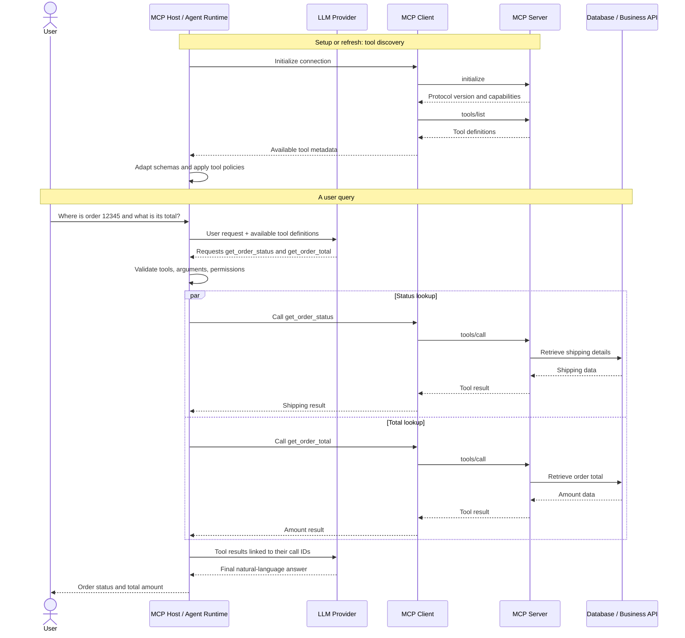

# How MCP Tools Become LLM Tools: Complete Workflow

> A GitHub-ready guide to understanding how an MCP Host, MCP Client, MCP Server, and LLM work together to execute tools in an AI agent.

## Table of Contents

1. [The Core Idea](#1-the-core-idea)
2. [The Main Components](#2-the-main-components)
3. [Two Different Workflows](#3-two-different-workflows)
4. [End-to-End Example](#4-end-to-end-example)
5. [Step 1: Discover MCP Tools](#5-step-1-discover-mcp-tools)
6. [Step 2: Convert MCP Metadata into LLM Tool Definitions](#6-step-2-convert-mcp-metadata-into-llm-tool-definitions)
7. [Step 3: Send the User Query and Tools to the LLM](#7-step-3-send-the-user-query-and-tools-to-the-llm)
8. [Step 4: The LLM Requests Tool Execution](#8-step-4-the-llm-requests-tool-execution)
9. [Step 5: The Host Dispatches the Tool Call Through MCP](#9-step-5-the-host-dispatches-the-tool-call-through-mcp)
10. [Step 6: Return Tool Results to the LLM](#10-step-6-return-tool-results-to-the-llm)
11. [Complete Sequence Diagram](#11-complete-sequence-diagram)
12. [How Many Calls Are Required?](#12-how-many-calls-are-required)
13. [What If There Are Many MCP Servers and Tools?](#13-what-if-there-are-many-mcp-servers-and-tools)
14. [Application-Managed MCP vs. Provider-Managed MCP](#14-application-managed-mcp-vs-provider-managed-mcp)
15. [Production Engineering Considerations](#15-production-engineering-considerations)
16. [Key Takeaways](#16-key-takeaways)
17. [Knowledge Check](#17-knowledge-check)

---

## 1. The Core Idea

Imagine you are building an AI customer-support agent. A user asks:

> Where is my order 12345, and what is its total amount?

Your application has an MCP server that exposes tools for retrieving order information.

The important distinction is that an **MCP tool**, an **LLM tool definition**, and a **tool execution** are three different things.

- **MCP tool:** A capability exposed by an MCP server.
- **LLM tool definition:** A schema that tells the model which operation it may request and what arguments it accepts.
- **Tool execution:** The application invokes the requested operation through an MCP client, and the MCP server runs the implementation.

The LLM does not normally execute the Python function itself. It requests a tool call. The host application decides whether and how to execute that request.

### A simple analogy

Think of a restaurant:

- The MCP server is the kitchen that can prepare dishes.
- The LLM tool definition is the menu that describes the available dishes.
- The LLM chooses what to order.
- The host application and its dispatcher act like the waiter, carrying the order to the kitchen.
- The MCP client communicates with the kitchen using the agreed protocol.

The menu describes what can be done; it does not perform the action.

---

## 2. The Main Components

### 2.1 MCP Host

The **host** is the AI application that coordinates the experience. It may contain:

- Agent runtime and orchestration logic
- LLM/provider integration
- One or more MCP clients
- Tool registry and dispatcher
- Conversation state
- Authorization and execution policies
- Logging, tracing, and error handling

### 2.2 LLM

The **large language model (LLM)** interprets the user's request and decides whether to request one or more tools, based on the context and tool definitions supplied to it.

The LLM may return a final answer directly if no tool is needed.

### 2.3 MCP Client

The **MCP client** is the component that communicates with an MCP server using the MCP protocol. It can initialize a session, discover tools, and invoke tools.

A host can manage multiple MCP clients, typically with each client connected to a particular server.

### 2.4 MCP Server

The **MCP server** exposes capabilities such as tools, resources, and prompts. For a tool call, it validates and dispatches the protocol request to the registered implementation, subject to the application's security and business rules.

### 2.5 External business system

The tool implementation may call a database, internal service, REST API, or another system. The external system usually holds the actual business data.

### Architecture overview

```text
                         USER
                           |
                           v
                 +-------------------+
                 |     MCP HOST      |
                 |                   |
                 |   Agent Runtime   |
                 |   LLM Integration |
                 |   Tool Registry   |
                 |   Policy Checks   |
                 +---------+---------+
                           |
                           v
                         LLM
                           |
              Tool-call request or final answer
                           |
                           v
                 +-------------------+
                 |     MCP HOST      |
                 |  Tool Dispatcher  |
                 +---------+---------+
                           |
                           v
                 +-------------------+
                 |    MCP CLIENT     |
                 +---------+---------+
                           |
                      MCP Protocol
                           |
                           v
                 +-------------------+
                 |    MCP SERVER     |
                 |   Tool Handler    |
                 +---------+---------+
                           |
                           v
                 +-------------------+
                 | Database / API   |
                 +-------------------+
```

---

## 3. Two Different Workflows

A common source of confusion is mixing up **tool discovery** and **tool execution**.

### Workflow A: Discovery

The client learns which tools a server exposes. This usually happens during setup or when the tool catalog needs to be refreshed.

```text
MCP Client
    |
    | initialize / capability negotiation
    v
MCP Server
    |
    | tools/list
    v
MCP Server returns tool metadata
    |
    v
MCP Client / Host
    |
    | Adapt supported schemas to the model's format
    v
LLM request can include the available tool definitions
```

Discovery does not normally happen from scratch for every user query. A host can cache tool definitions and refresh them when appropriate.

### Workflow B: Execution

When the LLM requests a tool, the host routes the request through the MCP client to the relevant MCP server.

```text
User query
    |
    v
Host sends query + tool definitions to LLM
    |
    v
LLM requests a tool call
    |
    v
Host validates and dispatches the request
    |
    v
MCP Client sends tools/call
    |
    v
MCP Server executes the tool
    |
    v
Tool result returns to Host
    |
    v
Host sends the result back to LLM
    |
    v
LLM produces a final answer or requests another tool
```

**Key point:** Discovery and execution are different operations. The client does not have to repeat `tools/list` every time it calls a tool.

---

## 4. End-to-End Example

Suppose the user asks:

> Where is my order 12345, and what is its total amount?

The order system contains this record:

```json
{
  "order_id": "12345",
  "status": "Shipped",
  "estimated_delivery": "2026-10-20",
  "total_amount": 2499,
  "currency": "INR"
}
```

The MCP server exposes two tools:

- `get_order_status(order_id)` — retrieves shipping information.
- `get_order_total(order_id)` — retrieves the order total.

The host makes these tool definitions available to the LLM. The LLM can then request both tools, potentially in the same model response.

The host dispatches the calls through the MCP client. The MCP server executes each function and returns results. The host supplies the results to the LLM, which writes a user-facing response.

Example final answer:

> Order 12345 has shipped and is expected to arrive on October 20, 2026. The total amount is ₹2,499.

The date and amount in this example are sample data, not live order information.

---

## 5. Step 1: Discover MCP Tools

An MCP server may register a tool using the Python SDK's FastMCP interface:

```python
from mcp.server.fastmcp import FastMCP

mcp = FastMCP("Order Management Server")


@mcp.tool()
def get_order_status(order_id: str) -> dict:
    """Get the shipping status of an order."""
    # Replace this with a real service or repository call.
    return {
        "order_id": order_id,
        "status": "Shipped",
        "estimated_delivery": "2026-10-20",
    }
```

The decorator registers the function as an MCP tool. The SDK uses its name, description, and type information to help expose a tool schema.

A client can request the server's tool list using the MCP `tools/list` method. Conceptually, a returned tool definition can look like this:

```json
{
  "name": "get_order_status",
  "description": "Get the shipping status of an order.",
  "inputSchema": {
    "type": "object",
    "properties": {
      "order_id": {
        "type": "string"
      }
    },
    "required": ["order_id"]
  }
}
```

This is **metadata**, not the function's Python source code and not the result of calling the tool.

The schema tells the client how the tool can be called. It does not explain every internal business rule or guarantee that the caller is authorized.

---

## 6. Step 2: Convert MCP Metadata into LLM Tool Definitions

Different LLM providers define their tool-calling schemas differently. An application-managed integration therefore needs an adapter between MCP metadata and the model provider's expected format.

For example, a function tool in the OpenAI Responses API has a structure similar to this:

```json
{
  "type": "function",
  "name": "get_order_status",
  "description": "Get the shipping status of an order.",
  "parameters": {
    "type": "object",
    "properties": {
      "order_id": {
        "type": "string"
      }
    },
    "required": ["order_id"],
    "additionalProperties": false
  },
  "strict": true
}
```

The main mapping is:

| MCP metadata | Model-facing function definition |
|---|---|
| `name` | `name` |
| `description` | `description` |
| `inputSchema` | `parameters` |
| MCP tool invocation through a client | Application-managed execution after a model tool request |

The `type`, `strict`, and `additionalProperties` fields are part of this example's model-facing schema, not fields that should be blindly copied from MCP.

### Simplified adapter example

The following example demonstrates the concept for a simple schema containing primitive fields. It is not a general-purpose JSON Schema converter.

```python
def mcp_tool_to_openai_tool(tool: dict) -> dict:
    """Adapt a simple MCP tool definition to an OpenAI-style tool."""

    schema = tool["inputSchema"]

    if schema.get("type") != "object":
        raise ValueError("This example supports object schemas only")

    properties = schema.get("properties", {})
    original_required = set(schema.get("required", []))

    # Strict-mode adaptation in this example requires every field.
    # Reject optional fields rather than silently changing their meaning.
    if original_required != set(properties):
        raise ValueError(
            "Optional fields need an explicit strict-schema conversion"
        )

    return {
        "type": "function",
        "name": tool["name"],
        "description": tool.get("description", ""),
        "parameters": {
            "type": "object",
            "properties": properties,
            "required": list(properties.keys()),
            "additionalProperties": False,
        },
        "strict": True,
    }
```

Example usage:

```python
mcp_tool = {
    "name": "get_order_status",
    "description": "Get the shipping status of an order.",
    "inputSchema": {
        "type": "object",
        "properties": {
            "order_id": {"type": "string"}
        },
        "required": ["order_id"]
    }
}

llm_tool = mcp_tool_to_openai_tool(mcp_tool)
```

The resulting `llm_tool` is a model-facing description. It does not contain the implementation and does not execute anything.

For production use, implement and test schema conversion for optional fields, arrays, nested objects, enums, nullable values, and any provider-specific restrictions. Preserve semantics or reject unsupported schemas rather than silently changing them.

The Python SDK's exact object attributes and the model provider's request schema can vary by SDK/API version, so use the current documentation when implementing this adapter.

---

## 7. Step 3: Send the User Query and Tools to the LLM

The host sends the user's request and the model-compatible tool definitions to the LLM.

Conceptual pseudocode:

```python
response = await call_llm(
    user_message=(
        "Where is my order 12345, "
        "and what is its total amount?"
    ),
    tools=[
        get_order_status_definition,
        get_order_total_definition,
    ],
)
```

This is illustrative pseudocode. `call_llm` and the tool definitions must be implemented using the actual provider SDK.

The LLM receives:

1. The user's request.
2. Instructions and relevant conversation context.
3. The available tool definitions.

The model can choose to return a normal text response or request one or more tools.

---

## 8. Step 4: The LLM Requests Tool Execution

For the example query, the model might request two tool calls:

```json
[
  {
    "name": "get_order_status",
    "arguments": {
      "order_id": "12345"
    }
  },
  {
    "name": "get_order_total",
    "arguments": {
      "order_id": "12345"
    }
  }
]
```

The exact representation depends on the LLM provider. Some APIs return tool arguments as a JSON-encoded string and provide a unique call ID.

**The model has requested the calls; it has not executed the Python functions.**

The host must:

1. Verify that each requested tool is permitted.
2. Parse and validate the arguments.
3. Check authorization and approval requirements.
4. Route the call to the correct MCP client/server.
5. Handle errors and timeouts.

Never treat model-generated tool arguments as trusted input.

---

## 9. Step 5: The Host Dispatches the Tool Call Through MCP

Once the host approves a tool request, it invokes the MCP client.

Using the Python MCP SDK, the central operation looks like this:

```python
result = await session.call_tool(
    "get_order_status",
    arguments={"order_id": "12345"},
)
```

Here, `session` is an initialized MCP client session connected to the server that exposes the tool.

The client sends a `tools/call` request through the negotiated transport. The MCP server dispatches the request to its registered implementation, which may query a database or call an external API.

A conceptual JSON-RPC request looks like this:

```json
{
  "jsonrpc": "2.0",
  "id": 2,
  "method": "tools/call",
  "params": {
    "name": "get_order_status",
    "arguments": {
      "order_id": "12345"
    }
  }
}
```

This message is illustrative. Real messages include protocol requirements and are handled by the SDK.

The server might return a result equivalent to:

```json
{
  "order_id": "12345",
  "status": "Shipped",
  "estimated_delivery": "2026-10-20"
}
```

MCP tool results may be represented as structured content, text content, or other supported content blocks. Normalize the result appropriately before sending it to your model.

---

## 10. Step 6: Return Tool Results to the LLM

After execution, the host sends the tool result back to the LLM. The result must be associated with the original tool call according to the model provider's API.

For example, a Responses API function-call output uses the corresponding `call_id`:

```json
{
  "type": "function_call_output",
  "call_id": "call_example_123",
  "output": "{"order_id":"12345","status":"Shipped"}"
}
```

The call ID above is a placeholder. In a real implementation, use the exact ID returned by the model.

The host then continues the model interaction, supplying the prior conversation and tool output according to the provider's API contract.

The LLM can now produce a final response, or it can request another tool if more information is needed.

Example final answer:

> Order 12345 has shipped and is expected to arrive on October 20, 2026. The total amount is ₹2,499.

The host returns the answer to the user.

---

## 11. Complete Sequence Diagram



The diagram illustrates an application-managed MCP integration. The host may execute independent tool calls concurrently if its implementation and the tools permit it.

---

## 12. How Many Calls Are Required?

For the example in which the LLM requests both tools in a single response:

| Operation | Typical count | Purpose |
|---|---:|---|
| Tool discovery (`tools/list`) | Usually during setup or refresh | Learn which tools are available |
| First LLM call | 1 | Interpret the request and request tool calls |
| MCP tool calls | 2 | Retrieve status and total |
| Second LLM call | 1 | Interpret results and generate the final answer |
| Database/API operations | Depends on implementation | Retrieve underlying business data |

Therefore, this example normally uses **two LLM calls and two MCP tool calls**, assuming the model requests both tools together and then generates a final answer.

This is not a fixed rule:

- If no tool is needed, the model may answer in one LLM call.
- If multiple tools are requested together, they may be executed before one follow-up LLM call.
- If the model needs another tool after seeing the first results, additional rounds may be required.
- Tool discovery usually happens earlier and is not necessarily repeated for every user query.

A tool call is not the same as an LLM call. One LLM response can request multiple tools.

---

## 13. What If There Are Many MCP Servers and Tools?

Imagine the application connects to several servers:

```text
Orders MCP Server       -> get_order, get_order_status
Payments MCP Server     -> get_payment, request_refund
CRM MCP Server           -> get_customer, update_customer
Knowledge MCP Server     -> search_documents, get_document
Support MCP Server       -> get_ticket, create_ticket
```

The host can maintain a registry mapping model-facing tool names to the server and tool that implement them.

Example:

```python
tool_registry = {
    "orders.get_order_status": {
        "server": "orders",
        "mcp_tool": "get_order_status",
    },
    "payments.get_payment": {
        "server": "payments",
        "mcp_tool": "get_payment",
    },
    "knowledge.search_documents": {
        "server": "knowledge",
        "mcp_tool": "search_documents",
    },
}
```

A simplified dispatcher could look like this:

```python
async def dispatch_tool(
    tool_name: str,
    arguments: dict,
    registry: dict,
    sessions: dict,
):
    entry = registry.get(tool_name)

    if entry is None:
        raise ValueError("Unknown or disallowed tool")

    server_name = entry["server"]
    mcp_tool_name = entry["mcp_tool"]

    session = sessions[server_name]

    return await session.call_tool(
        mcp_tool_name,
        arguments=arguments,
    )
```

This example assumes `sessions` contains initialized sessions and that the registry has already been filtered according to the current agent's permissions.

In a production system:

- Use namespaced tool names to prevent collisions.
- Restrict the available tools for each agent and user.
- Validate arguments against the relevant schema.
- Apply authorization at the business-resource level.
- Handle timeouts, retries, and connection failures.
- Avoid exposing an unnecessarily large tool catalog to the LLM.

Tool discovery tells the application what a server exposes; it does not grant the user permission to invoke every discovered tool.

---

## 14. Application-Managed MCP vs. Provider-Managed MCP

There are two common integration patterns.

### Pattern A: Application-managed MCP

```text
Your Host
   |
   +--> LLM Provider
   |
   +--> MCP Client --> MCP Server --> Business System
```

Your application discovers MCP tools, adapts schemas for the LLM, receives tool-call requests, and dispatches calls through MCP.

Advantages:

- Direct control over execution.
- Flexible orchestration and custom policies.
- Can integrate local or remote MCP servers.
- Easier to centralize custom routing and application-specific logic.

Trade-offs:

- You must implement and maintain schema adaptation, dispatch, result handling, and connection management.

### Pattern B: Provider-managed remote MCP

Some LLM platforms support a native MCP integration. The provider can connect to a configured remote MCP server and manage more of the protocol interaction.

```text
Your Application
       |
       v
LLM Provider with MCP Integration
       |
       v
Remote MCP Server
       |
       v
Business System
```

Advantages:

- Less custom integration code for supported use cases.
- Provider-managed tool discovery and invocation.

Trade-offs:

- Capabilities, security controls, and execution behavior depend on the provider.
- Local stdio servers generally need a separate bridge or a different integration pattern.
- You still need to configure access controls and validate the end-to-end security model.

Choose based on the provider's capabilities, deployment environment, and the degree of control your application requires.

---

## 15. Production Engineering Considerations

MCP standardizes communication, but it does not automatically make an agent application enterprise-ready.

### Security

- Authenticate users and remote clients.
- Authorize access to individual tools and records.
- Never trust model-generated identities or arguments.
- Keep credentials outside prompts and tool outputs.
- Require approval for sensitive actions when appropriate.
- Treat retrieved documents and tool results as potentially untrusted input.

### Reliability

- Set timeouts for model and tool calls.
- Use bounded retries for transient errors.
- Do not blindly retry non-idempotent operations.
- Use idempotency keys or deduplication for sensitive writes.
- Limit tool calls, execution time, and total agent steps.
- Return structured errors rather than silently fabricating results.

### Observability

Capture useful metadata such as:

- Trace and request IDs
- Tool name and MCP server
- Execution duration
- Success/failure status
- Model latency and token usage
- Retry counts and timeout events

Avoid logging secrets or unnecessary sensitive data.

### Testing

Test the system at multiple levels:

1. Unit-test business logic.
2. Integration-test MCP discovery and tool calls.
3. Test authorization and permission boundaries.
4. Test model tool selection and argument generation.
5. Evaluate final-answer accuracy.
6. Load-test concurrent requests and downstream failures.

### Schema compatibility

MCP input schemas and provider-specific function schemas are not necessarily interchangeable. Build a tested adapter that preserves semantics, handles supported JSON Schema features, and rejects unsupported transformations.

---

## 16. Key Takeaways

1. **MCP tools are server capabilities.** They expose operations through a standardized protocol.
2. **LLM tool definitions are descriptions.** They tell the model which tools it can request and which arguments they accept.
3. **The host is the coordinator.** It manages the LLM interaction, tool policies, and dispatch.
4. **The MCP client communicates with the server.** It handles protocol operations such as tool discovery and tool invocation.
5. **The LLM requests; the application executes.** A model tool call is a request, not direct execution of Python code.
6. **Discovery and execution are separate.** The host can cache tool metadata instead of rediscovering tools for every query.
7. **One LLM response can request multiple tools.** The number of LLM calls depends on how many reasoning/tool rounds are needed.
8. **Security belongs in the application and service layers.** Tool metadata is not authorization.
9. **Schema conversion requires care.** Provider-specific restrictions must be handled without silently changing the meaning of a tool's inputs.

### The workflow in one line

**User query → Host sends tools and context to LLM → LLM requests tool calls → Host validates and dispatches → MCP Client invokes MCP Server → results return to Host → Host sends results to LLM → LLM generates the final answer.**

---

## 17. Knowledge Check

Try answering these questions without looking back:

1. What is the difference between an MCP tool and an LLM tool definition?
2. Does the LLM execute the Python function directly?
3. Which component sends `tools/list`?
4. Which component sends `tools/call`?
5. Does tool discovery have to run for every user query?
6. Can a single LLM response request two tools?
7. Who validates whether a user is authorized to access an order?
8. Why does a tool dispatcher need a registry?
9. What happens if a tool succeeds but the response is lost?
10. Why is schema adaptation needed when integrating MCP with different LLM providers?

### Answers

1. An MCP tool is a capability exposed by a server; an LLM tool definition is a model-facing description of that capability.
2. No. The LLM requests a call; the application routes it to the MCP server.
3. The MCP client sends `tools/list` to the server.
4. The MCP client sends `tools/call` to the server after the host dispatches an approved request.
5. No. Discovery can happen during setup and be refreshed when needed.
6. Yes, if the model and integration support multiple tool calls in one response.
7. The application and underlying business service enforce authorization using a trusted identity.
8. It maps a model-facing tool name to the correct MCP server and tool implementation.
9. A retry could duplicate a non-idempotent action unless the operation uses appropriate idempotency or deduplication controls.
10. Different providers expect different tool-definition formats and may impose different schema constraints.

---

## Further Reading

- [MCP Architecture](https://modelcontextprotocol.io/docs/learn/architecture)
- [MCP Specification](https://modelcontextprotocol.io/specification/)
- [Official MCP Python SDK](https://github.com/modelcontextprotocol/python-sdk)
- [OpenAI Function Calling](https://platform.openai.com/docs/guides/function-calling)
- [OpenAI MCP and Connectors](https://platform.openai.com/docs/guides/tools-remote-mcp)

> **Implementation note:** Protocol and provider SDK details can change. Check the current documentation for the exact message schemas, SDK APIs, transport requirements, and security configuration before deploying.
